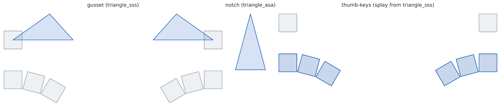
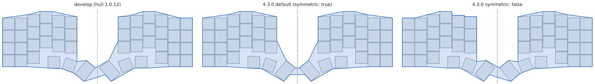
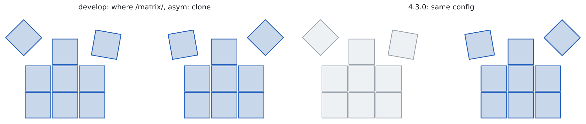

# Ergogen 4.3.0: the `outlines` release

*Draft summary of open PR [#160](https://github.com/ergogen/ergogen/pull/160), at `c7fc302`. Version 4.3.0 has not been published.*

Ergogen 4.3.0 ([#160](https://github.com/ergogen/ergogen/pull/160)) adds new ways to get shapes into `outlines`. You can now use SVG path data, SVG or JavaScript files from a bundle, a built-in Choc hotswap socket, and trigonometry solvers in any math expression. `hull` gets a symmetric mode, and it is on by default. The release also improves `$extends`, adds a `$concat` preprocessor, rejects misplaced keys, fixes mirror-axis expressions, empty filters and malformed mirror overrides, addresses two more issues caught during development, and updates Maker.js, js-yaml, yargs and the build tooling.

Compared with upstream `develop` (`8286e18`, 4.2.1), the branch (`c7fc302`) has 55 commits and changes 125 files (+17,219 / −1,250). The diff includes regenerated test references and dependency lockfile updates.

> [!IMPORTANT]
> Some existing configs will produce different output. Read [Compatibility notes](#compatibility-notes) before upgrading. The changes most likely to affect you: the order of `$extends` lists is reversed, `hull` outlines are redrawn, `asym: clone` behaves differently, and the YAML parser is stricter.

## New outline sources

### Inline SVG paths: `what: svg`

`paths` takes one SVG path `d` string or a list of them. Units are millimetres. The y axis points down, as in an SVG editor, so a shape looks the same as it does when you draw it. The shape is placed at every `where` point. On mirrored points it is mirrored left to right, like other outlines.

```yaml
points:
  zones:
    matrix:
      columns.c1:
      rows.r1:
  mirror.distance: 40
outlines:
  svg-path-multiple:
    - what: svg
      where: matrix_c1_r1
      paths:
        - M 0 0 L 0 -2.5 L -2.5 -2.5 L -2.5 0 Z
        - M 5 5 L 10 5 L 10 10 L 5 10 Z
  svg-path-flip:
    - what: svg
      where: true
      flip_vertically: true
      flip_horizontally: true
      origin: [-10, -10]
      paths: M 0 0 L 0 -2.5 L -2.5 -2.5 L -2.5 5 Z
```

| Field | Meaning |
| --- | --- |
| `paths` | A string or a non-empty list of strings. Every path must be closed. Separate paths are unioned; the subpaths of one path keep their holes. |
| `origin` | Point in Ergogen coordinates (y up) placed at the anchor: after SVG conversion, the shape shifts by `[-x, -y]`, before optional flips. For example, `origin: [3, 4]` anchors SVG point `(3, -4)`. Default `[0, 0]`; accepts math expressions. |
| `flip_horizontally`, `flip_vertically` | Mirror the shape before it is placed. |
| `accuracy` | Optional curve accuracy for Béziers. When left out, Maker.js picks one based on the size of each curve. |

The usual part fields also work: `where`, `asym`, `adjust`, `bound`, `fillet`, `expand`, `scale` and `operation`.


### SVG and JS outlines from bundles and the API

Put files in a bundle's `outlines/` folder and refer to them by their path within that folder, without the extension (`outlines/sub/foo.svg` becomes `what: sub/foo`). This works for `.zip`/`.ekb` bundles and for bundle folders, including symlinked `outlines/` folders.

```text
my-board/
├── config.yaml
└── outlines/
    ├── outline_injected_svg.svg ← what: outline_injected_svg
    └── outline_injected_js.js  ← what: outline_injected_js
```

```yaml
outlines:
  outline_injected_svg:
    - what: outline_injected_svg
      where: true
  outline_injected_js:
    - what: outline_injected_js
      where: true
```

- **SVG files** are read for path data only. Each `<path d="…">` becomes one entry of `paths`, and then they work exactly like `what: svg`. Export in millimetres. A `viewBox` must start at `0 0` and match `width`/`height` when those dimensions are present. Transforms, clipping, masks, markers, filters, nested `<svg>`, and shapes that are not paths (`<rect>`, `<circle>`, `<text>`, …) are rejected with an error that says what to do, for example *"transforms are not supported! Flatten transforms before exporting."* Comments, Inkscape metadata and unused `<defs>` are ignored. CSS does not hide or select paths.
- **JS files** export `(config, name, points, outlines, units) => [point => [model, bbox], units]`. They can `require` only `makerjs` (and `package.json`), the same rule as bundled footprints.
- **From code**, `ergogen.inject('outline', name, fn)` registers an outline factory.

Built-in and injected outlines are registered in the same place. An injected outline with a built-in name (for example `outlines/hull.js`) **replaces** that built-in.

### Built-in `choc_hotswap_socket`

This is a Kailh Choc hotswap socket outline. It uses a built-in origin of `[9.6, 1.5]` in Ergogen coordinates, shifting the converted shape by `[-9.6, -1.5]`. The default socket spans x = −9.6…4.6 mm and y = −8.2…−1.5 mm relative to the key centre, as shown above. `origin` adds to that built-in origin and accepts math expressions such as `[u/2, u]`. It also takes `flip_horizontally` and `flip_vertically`.

```yaml
outlines:
  choc:
    - what: choc_hotswap_socket
      where: true
      origin: [1, 2]
      flip_horizontally: true
```

## Trigonometry solvers

Any math expression Ergogen evaluates can use two solvers from Maker.js. The fixtures call them in `units`, `shift` and `orient`; `splay` then uses the calculated `step` unit. All angles are in degrees.

- `triangle_sss(opposite_side, side, other_side)` returns the angle opposite the first side.
- `triangle_asa(opposite_angle, side, other_angle)` returns the length of the side opposite the first angle, where `side` lies between the two angles.

Every argument must be a positive finite number, and the triangle must be possible. Otherwise Ergogen stops with an error that names the function.

```yaml
units:
  pitch: 21
  radius: 80
  # the splay that puts neighbouring keys exactly one pitch apart on an 80 mm arc
  step: triangle_sss(pitch, radius, radius)
points:
  zones:
    thumb:
      key:
        spread: 0
        origin: [0, -radius]
      columns:
        inner: {}
        home.key.splay: -step
        outer.key.splay: -step
outlines:
  notch:
    - what: polygon
      points:
        - shift: [0, 0]
        - shift: [30, 0]
        # formulas with commas need quotes inside flow arrays
        - orient: 105
          shift: ["triangle_asa(75, 30, 75)", 0]
```

In the full fixture, `step` evaluates to 15.0837°. The thumb key centres come out exactly 21.0000 mm apart, and the `gusset` triangle has sides of 60, 45 and 35 mm.



## `hull` is symmetric by default

`hull` used to build its outline by walking the points in one direction. On a mirrored board, the two halves could end up with different notches. `hull` now uses an order-independent algorithm from the [`ceoloide/hull`](https://github.com/ceoloide/hull) fork, so mirrored points give a mirrored outline. The new `symmetric` field controls this:

```yaml
outlines:
  symmetric-off:
    - what: hull
      symmetric: false   # default: true
      points:
        - matrix_c1_r1
        - matrix_c2_r1
        - mirror_matrix_c1_r1
        - mirror_matrix_c2_r1
```

On the board from [#162](https://github.com/ergogen/ergogen/issues/162) (`concavity: 40`, without `fillet` and `expand`):

| Build | Hull area | Worst distance from a mirrored vertex to the outline |
| --- | ---: | ---: |
| `develop` (hull 1.0.12) | 20,428.0 mm² | 13.660 mm |
| 4.3.0, default | 20,655.2 mm² | 0.000 mm |
| 4.3.0, `symmetric: false` | 20,124.8 mm² | 7.229 mm |



## `asym: clone` with filters that match both halves

Filters like `where: /matrix/` or `where: true` match both halves of a mirrored board. With `asym: clone`, they used to produce rectangles on both halves. In 4.3.0, when both halves of a pair match, only the source half is cloned, so `clone` gives the mirrored half, the same as it does for filters that are point names. Use `asym: both` to get both halves.

```yaml
outlines:
  clone-regex:
    - what: rectangle
      where: /matrix/
      asym: clone
      size: 18
```



## Preprocessing

### `$extends`

The following examples are preprocessing fragments; add a `points` block to use them as standalone Ergogen configs.

`$extends` is now resolved recursively. Inheritance targets that contain their own `$extends` (at any depth) are resolved before they are merged. In a list, **later targets override earlier ones**, and the object's own fields are applied last, `$unset` included.

```yaml
templates:
  a: {color: red, size: 1}
  b: {color: blue}
  base_part: {material: plastic}
  parent:
    structure:
      part: {$extends: templates.base_part, count: 1}
thing:
  $extends: [templates.a, templates.b]
main: {$extends: templates.parent}
```

| Result | `develop` | 4.3.0 |
| --- | --- | --- |
| `thing` | `{color: red, size: 1}` | `{color: blue, size: 1}` |
| `main` | `{structure: {part: {$extends: templates.base_part, count: 1}}}` | `{structure: {part: {material: plastic, count: 1}}}` |

### `$concat`

`$concat(...)` joins string literals, references to other config values, and nested `$concat` calls into one string. Literals take single or double quotes, and empty arguments are allowed. It runs after `$extends` and `$params`, before units are evaluated.

```yaml
meta:
  name: ThinkCorney
  version: v1-b1
  rev: 2
  name_full: $concat(meta.name, "-", meta.version)   # ThinkCorney-v1-b1
  file: $concat(meta.name_full, '_rev', meta.rev)    # ThinkCorney-v1-b1_rev2
```

References must point to a string, number or boolean. Missing references, references to objects, broken syntax and circular references stop with an error that names the location, for example *`Could not resolve reference "meta.nope" in $concat at "meta.v"`*.

### Reserved keys in `points`

Keys in the wrong level of the `points` tree used to be ignored without warning. They are now rejected. Examples are a `key:` block inside a row, `columns` or `rows` nested where they don't belong, and `zone`, `col` or `row` set inside a key declaration (these three are engine metadata).

```yaml
points.zones.thumbs:
  columns:
    cluster:
  rows:
    a:
      key:            # Reserved key "key" within field "points.zones.thumbs.rows.a":
        width: 1.5u   # this block is already a key-level config; move its fields up one level!
```

On `develop`, this config ran, but the key stayed 18 mm wide instead of `1.5u`.

## Bug fixes

| Issue | Example | `develop` | 4.3.0 |
| --- | --- | --- | --- |
| [#171](https://github.com/ergogen/ergogen/issues/171) | `mirror: u * 2` with `u: 19` | mirrored key at `(NaN, 0)` | mirrored key at `(76, 0)` |
| [#172](https://github.com/ergogen/ergogen/issues/172) | `where: []` / `where: [[]]` | `Reduce of empty array with no initial value` | `[]` matches no points, `[[]]` matches all |
| [#173](https://github.com/ergogen/ergogen/issues/173) | `what: svg` with `paths: []` | n/a (`svg` is new; earlier builds of this branch threw a raw `TypeError`) | `SVG outline "…" must have at least one path!` |
| [#174](https://github.com/ergogen/ergogen/issues/174) | `key.mirror: 5` | `Cannot read properties of undefined (reading 'name')` | `Field "matrix_c.mirror" should be of type object!` |
| [#175](https://github.com/ergogen/ergogen/issues/175) | bundle folder with symlinked `footprints/` or `outlines/` | worked (`develop` follows them); the regression came from `6233bd2` on this branch | linked folders followed again |

Mirror-axis unit names (`u`) and math expressions are now evaluated. Quoted numeric axes and anchors with `distance` already worked on `develop`. Fixes made while the SVG importer was being built: it rejects arcs whose endpoints almost, but not exactly, coincide, turns zero-radius arcs into straight lines as the SVG spec requires, and lets Maker.js choose the curve accuracy unless `accuracy` is set.

## Dependencies and tooling

Versions prefixed with `^` are manifest ranges; the lockfile pins the installed versions.

| Package | Before | After |
| --- | --- | --- |
| `makerjs` | ^0.18.1 | ^0.19.2 |
| `js-yaml` | ^3.14.1 | ^4.1.1 (locked to 4.2.0) |
| `yargs` | ^17.7.2 | ^18.0.0 |
| `mathjs` | ^15.0.0 | ^15.2.0 |
| `hull` | `andriiheonia/hull` (1.0.12) | `ceoloide/hull#4a8a914` (1.0.13 plus the symmetric mode) |
| dev: `rollup`, `@rollup/plugin-commonjs`, `glob`, `nyc`, `sinon` | 4.52 / 28 / 11 / 17 / 21 | 4.62 / 29 / 13 / 18 / 22 |

- `package.json` now declares `engines.node: ^20.19.0 || ^22.12.0 || >=23`, the same range yargs 18 requires.
- CI runs on Node 24 with `actions/checkout@v7` and `actions/setup-node@v6`.
- Solvers live in a private mathjs instance, so the global `mathjs` is left alone.
- The Rollup build has a plugin that turns `.svg` imports into outline factories, for future built-in SVG outlines. No built-in uses it yet.

## Compatibility notes

1. **`$extends` lists apply in the opposite order.** In `[a, b]`, `b` now wins. Configs written for the old order (first item wins) need their lists reversed.
2. **`hull` outlines change shape.** Mirrored boards get a symmetric outline, and one-sided hulls can also change shape. `symmetric: false` disables the new symmetric mode, but on some boards the result is still not identical to `develop`, because the library's non-symmetric mode was updated too. The pre-existing `defaults`, `concavity-low` and `rotation` fixtures still differ from `develop` with `symmetric: false`; the dedicated `symmetric-off` fixture matches the old `mirror` geometry. On the #162 board the opt-out changes the area from 20,428.0 to 20,124.8 mm². Recheck generated outlines when upgrading.
3. **`asym: clone` with filters that match both halves** now gives only the mirrored half. Use `asym: both` to keep the old output.
4. **The YAML parser is stricter (js-yaml 4, YAML 1.2).** Flow lists with empty items, such as `bind: [,10,,]`, are rejected. For explicit zeros write `[0, 10, 0, 0]`; to retain inherited slots use `[~, 10, ~, ~]`. Invalid top-level configs can produce `Input is not valid YAML, JSON, or JS Code!`; invalid KLE notes are ignored, while invalid string-encoded structured footprint parameters surface a YAML parse error. Numbers with underscores, like `1_0`, become strings: in `units` they fail with `Undefined symbol _0`, and in numeric fields with a type error. Leading-zero `010` changes silently from octal 8 to decimal 10; use `0o10` for octal. `1:30` becomes a string rather than 90.
5. **Misplaced keys in `points` and non-object `mirror` overrides now stop with an error** instead of being ignored or crashing.
6. **Bundle outlines can replace built-ins.** A file named `outlines/rectangle.js` overrides `what: rectangle`.
7. **The CLI needs Node ^20.19, ^22.12 or ≥23**, because of yargs 18.
8. **Browser and UMD users must supply updated globals.** `dist/ergogen.js` keeps `makerjs`, `js-yaml`, `mathjs`, `hull`, `jszip` and `kle-serial` external. A host page (including the web UI) needs Maker.js 0.19.2, js-yaml 4 and the forked `hull`. An older `hull` global ignores the `symmetric` option without any error and draws the old outline.
9. **Exported files differ in text even when the geometry is the same.** DXF files gain `DASHED`/`DOTTED` line types and a `CONTINUOUS` line type on each entity. SVG paths can start at a different corner or wind the other way. YAML dumps no longer quote values like `0_0`. Any tooling that compares outputs byte for byte needs new references.

## Verification

- Checked at `c7fc302` after installing locked dependencies, with Node 24.22.3 and npm 12.2.3:
  - `npm test`: 436 passing
  - `npm run coverage`: 100% statements, branches, functions and lines
  - `npm run build`: succeeds
- GitHub check `build` on head `c7fc302`: success.
- Before/after comparisons run the same configs through `develop` (`8286e18`) and `c7fc302`. The SVG/socket and solver figures use `c7fc302` only, since those features are new.
- Not tested: the web UI with the new globals, KiCad import of the generated PCBs, and Windows junctions for symlinked bundles (the `linked_bundle` CLI test creates them, but only ran on Linux here).

---

## Appendix: figures

Every image is rendered from the outline geometry that Ergogen returns: the points layer is the `demo` output (gray), and the outlines are the `outlines.<name>` models (blue). Nothing is redrawn by hand.

| File | Source config | Build(s) | Layers |
| --- | --- | --- | --- |
| `assets/pr160/svg-outlines.png` | `test/outlines/svg.yaml` (`svg-path-mirror`, including its stacked 20 mm reference squares), plus a 2×2 matrix with `mirror.distance: 60` and `what: choc_hotswap_socket, where: true` | `c7fc302` | demo points + outline |
| `assets/pr160/solvers.png` | `test/outlines/solvers.yaml` (`gusset`, `notch`, `thumb-keys`) | `c7fc302` | demo points (not on `notch`) + outline |
| `assets/pr160/hull-symmetric.png` | the issue #162 config without `fillet: 2` and `expand: 2`, plus a copy with `symmetric: false` | `8286e18`, `c7fc302`, `c7fc302` | demo points + `_hull` + mirror axis, `(matrix_pinky_home.x + mirror_matrix_pinky_home.x) / 2` |
| `assets/pr160/asym-clone.png` | `test/outlines/asym_filter.yaml` (`clone-regex`) | `8286e18`, `c7fc302` | demo points + outline |

## Appendix: source pointers

- Outline registry and injection: `src/outlines.js` (`whats`, `svg`, `inject_outline`), `src/outlines/index.js`, `src/ergogen.js` (`case 'outline'`)
- SVG import: `src/svg.js` (`extract`, `path_data`), `src/utils.js` (`svg_paths_to_outline`), `src/io.js` (the bundled outlines loop), `rollup.config.mjs` (`svg_outline_plugin`)
- Fixtures: `test/outlines/svg.yaml`, `test/outlines/svg_paths_*.yaml`, `test/outlines/svg_not_closed.yaml`, `test/unit/svg.js`, `test/fixtures/bundle/`, `test/cli/bundle`, `test/cli/linked_bundle`
- Choc socket: `src/outlines/choc_hotswap_socket.js`; `test/outlines/outlines.yaml` (`choc`, `choczero`), `test/outlines/choc_hotswap_socket_origin.yaml`
- Solvers: `src/assert.js` (`solvers`, `mathnum`); `test/outlines/solvers.yaml`, `test/unit/assert.js`
- Hull: `src/outlines.js` (`symmetric`); `package.json` and `package-lock.json` (`hull` pinned at `4a8a9147`); `test/outlines/hull.yaml` (`symmetric-off`); fork PR [ceoloide/ergogen#41](https://github.com/ceoloide/ergogen/pull/41)
- Filters: `src/filter.js` (`_and`, `_or`, the `clone` branch); `test/outlines/asym_filter.yaml`, `test/unit/filter.js`
- Preprocessing: `src/prepare.js` (`inherit`, `overlay`, `parse_concat`, `concat`); `test/unit/prepare.js`
- Points: `src/points.js` (`check_key_reserved_fields`, `parse_axis`, `perform_mirror`); `test/points/mirror_axes.yaml`, `test/points/reserved_*.yaml`, `test/points/mirror_zone_relabel.yaml`
- CLI and bundles: `src/cli.js` (`hideBin`, `withFileTypes` plus `stat` on symlinks)
- Output format changes: regenerated `*.dxf` references, `test/cli/minimal_kle/reference/points/points.yaml`, `test/cli/big/reference/outlines/export.svg`
- YAML parser fixture change: `test/outlines/basic.yaml` (`[,10,,]` replaced by `[0, 10, 0, 0]`)
